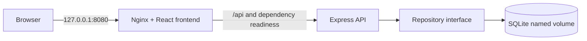

# Enterprise Agentic SDLC & Reliability Platform

An engineering project for building and operating a small commerce application
through a traceable software delivery lifecycle. **Morrow Supply** is the
working reference application. The repository implements local commerce,
automated verification, container packaging, and GitHub Actions validation.
It also defines the target Azure deployment and agent-assisted operations.

The engineering objectives are to:

- Deliver small, reviewable changes with reproducible tests and security evidence.
- Verify application behaviour across browser, API, persistence, and container boundaries.
- Detect dependency failures that a healthy static page can hide.
- Define scoped agent permissions, human release approval, and independent
  recovery verification before introducing operational automation.

## Architecture and implemented components



- **Frontend and proxy.** The browser uses same-origin `/api` requests. Docker
  Compose publishes only the frontend on loopback and keeps the API on the
  Compose network. Native development uses a Vite proxy.
- **API and persistence.** Express validates inputs and calculates authoritative
  cart totals. Repository adapters own persistence and transaction logic.
  SQLite is the default local store, with explicit, checksummed migrations
  and seed data. File-backed SQLite contracts run against a real database.
- **Optional OIDC.** The browser uses authorization code with PKCE and verifies
  the ID token before exposing an in-memory session. The API validates the
  access token and derives cart ownership from its verified issuer and subject.
  Local tests exercise the real client and cryptography with simulated provider responses.
- **SQL adapter.** Parameterized SQL, transactions, and migration entry points
  are implemented. Recording-driver tests simulate the database boundary.
  SQL Server and Azure SQL integration remain unverified.
- **Azure infrastructure.** Eight Bicep templates define the target Azure
  Container Apps environment, external HTTPS frontend, internal API, private
  Azure SQL networking and DNS, scoped identities, a separate migrator, and
  diagnostics with export disabled. The definitions were compiled and checked
  statically. Deployment and live enforcement remain pending.

See [architecture](docs/architecture.md), [persistence and recovery design](docs/decisions/0003-persistence.md),
and [infrastructure contracts](infra/README.md).

## Morrow Supply

Morrow Supply is an independently developed commerce demo with 12 synthetic
products, original illustrations, and its own UI, API, schema, and tests.
OctoCAT Supply is the conceptual reference. [Source and attribution record](THIRD_PARTY_NOTICES.md)

- Browse the catalogue, view product details, and search, filter, or sort products.
- Create a cart, set absolute quantities, and remove items. Valid repeated
  quantity updates produce the same cart state.
- Calculate prices on the server in integer pence. A subtotal of £300 or more
  receives a 10% discount, rounded down to whole pence.
- Retain cart data across local API restarts and container replacement with the
  same volume. The default demo uses anonymous carts and is for loopback use.

The demo covers catalogue and cart behaviour with synthetic data. Checkout,
payments, and real customer data are outside its scope. [Application guide](apps/octocat-supply/README.md)

## Secure CI/CD and DevSecOps

The [GitHub Actions CI workflow](.github/workflows/ci.yml) runs on pull requests
targeting `main`, pushes to `main`, and manual dispatch. The mandatory jobs
use read-only repository permissions, validate changes, and build test images.
Registry publishing, cloud deployment, and release federation remain design
work. Actions and container bases are pinned to immutable references.

| Job | Required validation |
| --- | --- |
| `application` | Locked dependency install, licence inventory, formatting, lint, type checks, build, tests, Playwright journeys, OIDC mutation and capture checks, and npm audit at the high threshold. |
| `policy` | Workflow and infrastructure policies, Bicep compilation, repository checks, Gitleaks history and worktree scans, and Trivy configuration scanning. |
| `containers` | Image build and runtime checks, HTTPS proxy and browser smoke tests, Trivy image scanning, CycloneDX SBOMs, and build provenance. |
| `required` | Requires success from all three mandatory jobs and applies the CodeQL opt-in policy. |

Mandatory validation passed in hosted runs including **43407086701** at
`e9b5704` and **44380044262** at `2e0bd25`. **CodeQL was skipped and did not
execute.** Its opt-in flag was absent, and private-repository eligibility
remains unestablished. The aggregate CI result records validation on the cited
revisions. Branch protection and independent release approval remain open.
[Secure delivery](docs/delivery.md) · [C5 readiness assessment](docs/evidence/m4c-c5-readiness.md) ·
[Hosted CI context](docs/evidence/m4c-c5-g4h-hosted-gate-execution.md#limitations-and-residual-risks)

## Agentic SDLC and reliability architecture

**Implemented and locally tested.** The API emits request identifiers and safe
errors. API liveness checks the process, while readiness checks the database and
expected seed data. Frontend readiness follows the same API upstream as
application traffic. A local container exercise verified that a wrong upstream
port leaves the static homepage available while readiness and API journeys
fail, and that restoring the port recovers those journeys. [Local reliability evidence](docs/evidence/m2-baseline.md)

**Design only.** The target workflow takes an approved requirement or incident
finding through scoped implementation, automated checks, independent review,
and an authorized release. Incident investigation uses read-only telemetry
and change history. The handoff records impact, evidence, and acceptance
criteria in GitHub. An authorized operator or approved tool executes recovery,
and fresh journey checks verify the outcome.

The design separates read, propose, and execute permissions. Issue and log
content is treated as untrusted input. Agentic maintenance, live observability,
SLO and error-budget monitoring, and automated incident-to-PR integration remain
planned. Historical lab outcomes are recorded separately. [Agent permission design](docs/decisions/0004-agent-execution-permissions.md) ·
[Validation strategy](docs/validation-strategy.md) · [Historical evidence](docs/historical-reuse.md)

## Technology stack

| Area | Technologies |
| --- | --- |
| Web and API | React, Vite, TypeScript, Express, Node.js 24.22.2, npm 11.19.1 |
| Data and identity | Node `node:sqlite`, `mssql`/Tedious adapter, `oidc-client-ts`, JOSE |
| Testing and runtime | Vitest, Playwright, Nginx, Docker and Compose |
| Delivery and security | GitHub Actions, Python, actionlint, Gitleaks, Trivy, CycloneDX, Semgrep CE for limited trials |
| Azure target | Bicep, Container Apps, Container Registry, Azure SQL, Microsoft Entra ID, Azure Monitor and Log Analytics |

## Security controls and validation evidence

- **Application and identity.** Owner-scoped cart access, signed-token and
  claim checks, verified HTTPS proxying, and credential-safe capture controls
  are exercised locally. C1 records 27 shared repository cases plus six
  SQLite regressions. C3 records 195 passing application tests and seven
  simulated-provider browser journeys. [C1 evidence](docs/evidence/m4c-c1-repository-contracts.md) ·
  [C3 evidence](docs/evidence/m4c-c3-oidc.md)
- **Containers and infrastructure.** Local containers use non-root users,
  read-only root filesystems, and dropped capabilities. The recorded C4
  image and configuration scans reported zero HIGH/CRITICAL findings, and
  static policy tests exercised rejected infrastructure changes. Diagnostic
  redaction was checked with a local reference model. [M3 evidence](docs/evidence/m3-secure-delivery.md) ·
  [C4 evidence](docs/evidence/m4c-c4-infrastructure.md)
- **Semgrep trials.** Hosted runs **43478654843** (Docker isolation) and
  **44393309563** (Semgrep CE 1.186.0 with TypeScript syntax preflight) passed
  their respective non-blocking trial criteria. G4 is closed for TypeScript
  only. JavaScript remains outside its scope. Mandatory CI SAST (E04) is
  **NO-GO**. [Docker trial](docs/evidence/m4c-c5-f4r-hosted-trial-execution.md) ·
  [TypeScript-gated trial](docs/evidence/m4c-c5-g4h-hosted-gate-execution.md)

### R2(a) trial controls

| Step | Implemented and verified offline |
| --- | --- |
| P1 | Driver rejects input unless the event is an owner dispatch on `main` in the pinned repository. [Evidence](docs/evidence/m4c-c5-r2a-p1-trusted-input.md) |
| P2 | The trial job checks repository, actor, event, and ref before running, then checks trust again immediately after checkout. [Evidence](docs/evidence/m4c-c5-r2a-p2-workflow-trust.md) |
| P3 | An offline verifier checks approved input hashes and the six-file artifact against independent GitHub run metadata and Git history. [Evidence](docs/evidence/m4c-c5-r2a-p3-artifact-verification.md) |
| P4 | A read-only checker validates repository access, Actions settings, and approved trial files on `main`. Verification used offline fixtures. [Evidence](docs/evidence/m4c-c5-r2a-p4-governance-check.md) |

The historical Run 1 replay establishes artifact integrity only. It predates
P1–P4 and the explicit package-manager cache disablement. The P4 live check,
P5/P6, and broader R2(a) approval remain pending.

## Current project status

| Status | Scope |
| --- | --- |
| Implemented and locally tested | Morrow Supply, SQLite contracts, proxy and container checks, OIDC client and API controls, static Bicep validation, and offline trial controls. |
| Hosted-verified | Mandatory validation jobs and separate non-blocking Semgrep feasibility on their recorded revisions. |
| Simulated | OIDC provider responses and SQL recording-driver behaviour. |
| Design only / planned | Azure runtime and release execution, agentic maintenance, live telemetry and SLOs, incident handoffs, and cloud recovery. |
| Blocked / NO-GO | Production release and deployment, real SQL and provider integration, C5-A1/A2 acceptance, mandatory SAST, and independent release governance. |

The recorded C5 assessment found `main` unprotected and no deployment
environments. Azure session, permissions, and quotas remain unverified.
Live provider or cloud access, credential changes, GitHub settings changes,
ARM validation or what-if, and paid inference require separate owner
authorization. Missing Azure access leaves preflight blocked.
[M4A preflight](docs/milestones/m4a-preflight.md) · [M4C work packages](docs/milestones/m4c-scope.md)

Semgrep CE 1.186.0 is limited to hash-bound local scans of the trusted
repository through the hardened harness and separately authorized non-blocking
hosted trials. Conditional acceptance expires **2026-12-17**. Stop scanning on
expiry, pinned-input drift, or another documented stop condition. G2/G5 remain
open without waivers. SBOM v3 is the current assessment baseline. Redistribution
of the wheels, wheelhouse, virtual environment, or trial image is prohibited.
A future hosted run requires separate
owner authorization, owner commit and push, and same-day rechecks. The P4 live
check also requires separate authorization. [Adoption and stop conditions](docs/evidence/m4c-c5-u1e-adoption-decision.md) ·
[Approved hash rebinding](docs/evidence/m4c-c5-u1e-addendum-1-guard-rebinding.md)

## Local setup and testing

Use Node.js **24.22.2** and its bundled npm **11.19.1**. From the repository root,
install the locked packages, prepare the synthetic database, and start the API.

```sh
cd apps/octocat-supply
npm ci --ignore-scripts
npm run db:migrate
npm run db:seed
npm run build:api
npm run start:api
```

In a second terminal in `apps/octocat-supply`, run `npm run dev:web` and open
`http://127.0.0.1:5173`. For the Nginx/API Compose setup on
`http://127.0.0.1:8080`, see the [application guide](apps/octocat-supply/README.md#production-containers-on-localhost8080).

From the application directory, run the application and browser suites.

```sh
npm run format:check
npm run lint
npm run typecheck
npm run build
npm test
npm exec -- playwright install chromium
npm run test:e2e
npm run test:e2e:oidc
```

From the repository root, use Python 3.10 or newer for documentation and
local Markdown link checks.

```sh
python3 scripts/check_repository.py
git diff --check
```

## Documentation and licence

- Project direction and acceptance criteria. [Master brief](docs/project/master-brief.md) · [Requirements](docs/requirements.md) · [Roadmap](docs/roadmap.md)
- Project foundation and source decisions. [Charter](docs/project-charter.md) · [M1 design scope](docs/milestones/m1-scope.md) · [Fresh-start decision](docs/decisions/0001-start-fresh.md)
- Evidence and validation limits. [Capability matrix](docs/capability-status.md) · [Threat model](docs/threat-model.md) · [Release identity design](docs/decisions/0005-delivery-identity.md)
- Detailed scanner and governance records. [C5 plan and evidence index](docs/milestones/m4c-c5-sast-plan.md) · [Robustness evidence](docs/evidence/m4c-c5-e03-robustness.md) · [Risk decision history](docs/evidence/m4c-c5-g5d-security-risk-decision.md)
- Original project code is licensed under MIT. Third-party packages and base
  images retain their own terms. [MIT licence](LICENSE) · [Third-party notices](THIRD_PARTY_NOTICES.md)
