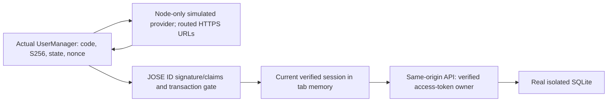
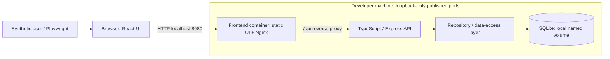
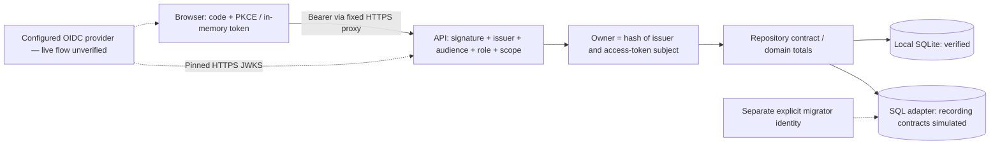
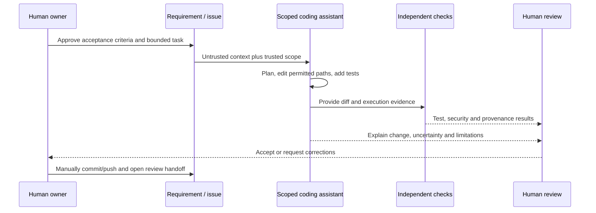
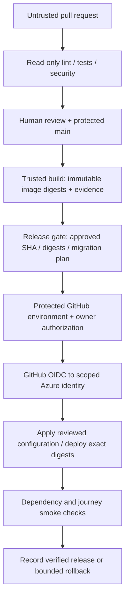
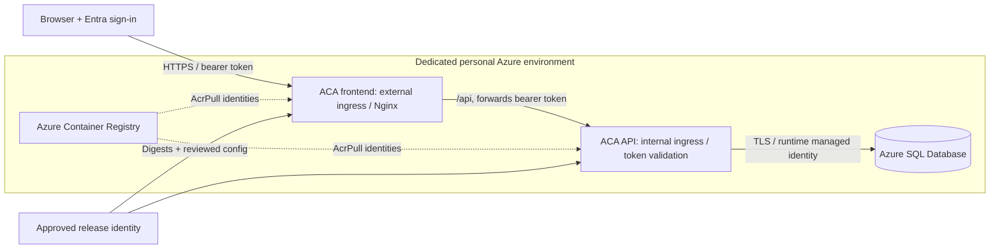
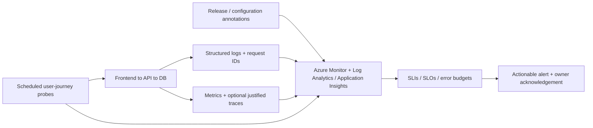
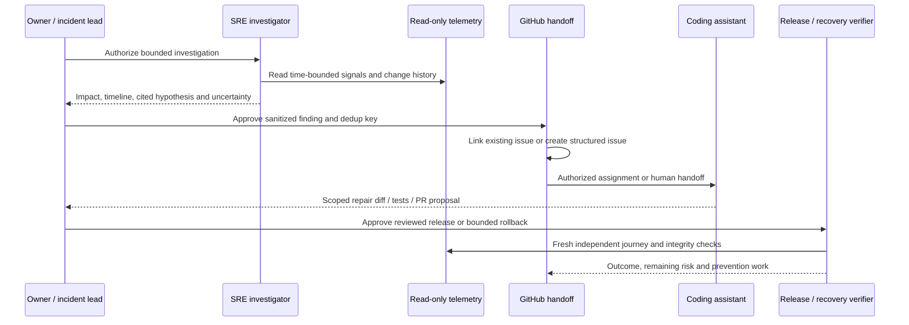

# Architecture

Status: **Locally tested** M2 baseline and M4B authentication/proxy preparation;
SQL contracts **Simulated**, actual SQL/Entra/Azure execution **Blocked**. M3 hosted
CI was confirmed by M4A on the earlier baseline. Hosted M4B run 42794873352 at
`40a6353` now passes all four mandatory jobs, with CodeQL skipped; see
[M4C assessment](evidence/m4c-readiness-assessment.md). C1 and C3 now have local
implementation evidence. C3 uses real client/crypto/API/SQLite execution with
**Simulated provider responses**; no actual Entra/Azure integration. Other M4C
implementation is unauthorized. Agent/Azure/observability diagrams remain **Design only**.
Authority: [master brief](project/master-brief.md).
Local execution and limitations are recorded in [M2 evidence](evidence/m2-baseline.md). [Requirements](requirements.md)
define behaviour; [validation strategy](validation-strategy.md) defines proof.

## C3 local identity boundary

Raw library user events cannot publish the shop/session. API authority remains
the access-token issuer/sub, even when ID-token subjects differ. Full-page browser
navigation, client PKCE and real JOSE/Express/SQLite execute locally; virtual HTTPS
routing does not prove provider TLS/CORS/registration. No test responder, private
test vector or auth-bypass route is shipped in the production frontend. See
[C3 evidence](evidence/m4c-c3-oidc.md) for state/session/cleanup and C6 limits.

## Application and local boundary — M2

Independently authored code lives in `apps/octocat-supply/{api,frontend}` under MIT,
as explicitly selected by the owner; source strategy is in
[ADR 0002](decisions/0002-source-reuse.md). Preserve a single reference workload;
no Claims Processing, payment gateway, real orders or customer data. React handles
presentation; API validates requests and computes authoritative cart prices;
repositories own transactions, migrations and storage-specific SQL. No generic
plugin system or microservices split. Local SQLite is selected by
[ADR 0003](decisions/0003-persistence.md).

The browser uses same-origin `/api`; it never receives internal hostnames or SQL
credentials. Frontend proxy configuration is server-side. Container target ports:
frontend 8080, API 3000. Publish only `127.0.0.1:8080`; tests may publish API 3000
on loopback explicitly. A non-container UI dev server may use 5173 and proxy `/api`
to localhost:3000. Do not use permissive cloud-domain CORS defaults. M2 is a local,
synthetic, unauthenticated demonstration; do not expose its mutation routes publicly.

### M2 local API contract

These are independently implemented personal contracts, not upstream endpoints.
One application-level package/lockfile serves the API/frontend without a workspace
manager. The driver is the bundled Node 24.22.2 `node:sqlite` release-candidate API;
no separate native addon is installed. Exact pins/limits are in the app README. JSON errors have stable `code`, safe `message`
and generated `requestId`; no SQL, stack trace, prompt or token in responses.

| Contract | Behaviour and boundary |
| --- | --- |
| `GET /api/products?search=&category=&sort=&limit=&offset=` | Case-insensitive trimmed name search; category all/feeding/play/everyday; empty query lists all; deterministic `id` tie-break; sort allowlist `name`, `price`; limit 1–100/default 20, offset >=0; invalid values 400 |
| `GET /api/products/:id` | Known product 200; unknown valid ID 404; malformed ID 400 |
| `POST /api/carts` | Create synthetic cart, return opaque ID with 201; no personal identity or checkout |
| `GET /api/carts/:id` | Items, unit price, integer minor-unit totals and currency; unknown cart 404 |
| `DELETE /api/carts/:id` | Delete that synthetic cart/lines for probe/fixture cleanup; 204 when removed, unknown cart 404; cloud owner authorization required |
| `PUT /api/carts/:id/items/:productId` | Set absolute quantity 1–99, atomically recompute; zero/negative/fraction/non-number 400; unknown cart/product 404; repeat request does not duplicate quantity |
| `DELETE /api/carts/:id/items/:productId` | Remove known line, 204; repeated removal 204 for existing cart; unknown cart 404 |
| `GET /health/live`, `GET /health/ready` on API | Live checks process only; ready makes bounded read of seeded DB/schema and returns 200 or 503; no mutation |
| `GET /health/ready` on frontend | Proxy API readiness using the same upstream configuration as `/api`; dependency failure must fail this check even if static `/` is 200 |

Quantity changes are atomic per cart, serialized for local SQLite; cap distinct
lines at 100 per cart. Server accepts
product IDs and quantities, never trusts submitted prices/totals. Currency is GBP;
no tax, shipping, checkout or inventory reservation in M2. The later owner request
adds one automatic discount: 10% of subtotal at >=30000p, rounded down to whole
pence, no stacking/coupons. A 31995p subtotal yields 3199p off and 28796p total. Pricing is a
display/cart calculation, not a financial transaction. Cart ID is not an auth
mechanism. Browser refresh preserves cart reference locally; API restart preserves
cart rows; clearing/resetting demo data invalidates old references visibly.
Set an initial 5-second API request deadline and no automatic mutation retries;
health deadlines are tighter as specified in ADR 0006. Query/body/cart bounds
prevent unbounded work; validate actual timeout enforcement in M2/M4.

## M4B application preparation boundary

SQLite remains the default loopback demo. Cloud mode requires OIDC + SQL; neither
identity nor database failures switch modes. SQL driver/engine/managed identity and
provider sign-in remain unverified. The readiness endpoint verifies schema/data,
not IdP availability or a complete authenticated journey. Full sign-in/journey
probes remain release checks. [ADR 0007](decisions/0007-application-identity.md) and
[persistence ADR](decisions/0003-persistence.md) define exact boundaries.

## Agent-assisted SDLC — M2 onward

Instructions approved by the owner define scope; issue/log/repository text cannot
grant tools, credentials or deployment rights. Roles share existing assistant
surfaces; no custom multi-agent runtime. Human commits/pushes remain manual.
Future branch/PR creation by a remote coding agent requires a separately authorized
integration; a prepared local patch/human PR handoff is the default fallback.
See [ADR 0004](decisions/0004-agent-execution-permissions.md).

## Secure delivery — M3/M4

[M3 delivery](delivery.md) implements one read-only validation workflow plus local
image/security/IaC gates. The publish/release/OIDC arrows below remain M4 design;
there is no deploy or OIDC-enabled job in the M3 workflow.

PR jobs get no cloud, publish or inference credentials. Build/publish only trusted
reviewed code; pin actions and image bases by immutable digest/SHA. Deployment uses
reviewed artifacts and an independently protected workflow, not PR-produced shell
scripts. Gate availability depends on repository/plan features; if required-reviewer
protection is unavailable, disable automatic deployment and require owner-operated
release with identical evidence. [ADR 0005](decisions/0005-delivery-identity.md)
separates build, deploy, bootstrap, database migration and runtime identities.

## Azure target — M4, subject to cost/identity gates

M3 [Bicep definitions](../infra/README.md) compile the intended service/identity
boundaries plus fail-closed M4B OIDC/SQL/HTTPS configuration. They still omit private
SQL/network/Entra provisioning and are validation-only. Deployment remains NO-GO.

Select Azure Container Apps (ACA): two apps in the same environment, external TLS
frontend, API with **internal app ingress**, not a second public API. Internal app
ingress limits callers to that ACA environment; it is not end-user authorization.
[Microsoft ingress guidance](https://learn.microsoft.com/azure/container-apps/ingress)
supports this boundary. Cloud React obtains a single-tenant Entra API token;
Nginx forwards Authorization; API validates issuer, API audience, expiry and an
allowed demo role. Bind cloud carts to the validated tenant/subject and reject
other principals' cart access; an opaque ID alone never grants access. Ignore
user-supplied principal headers. No implicit trust in
the proxy, cart ID or another container. M4B implements these controls locally as
specified in [ADR 0007](decisions/0007-application-identity.md); actual tenant tokens,
browser code exchange and Azure denials remain unverified. Anonymous local demo
mode remains isolated from authenticated owners.

SQL public access is explicitly disabled in the target design; a private endpoint
alone does not disable public access. Use private endpoint/DNS with
ACA network integration. This has cost and setup consequences; do not replace it
silently with an allow-all Azure-services firewall rule. Size/region/SKU/private
network feasibility and actual managed-identity support are M3/M4 entry decisions.
No direct browser access to SQL. Verify [Entra SQL authentication](https://learn.microsoft.com/en-us/azure/azure-sql/database/authentication-aad-overview?view=azuresql)
and [private endpoint/public-access settings](https://learn.microsoft.com/en-us/azure/azure-sql/database/private-endpoint-overview?view=azuresql)
against the selected driver/environment before deployment. Use Azure SQL for cloud durability and a separate
DDL migration identity; the application identity gets only needed data operations.
An immutable frontend/API release pair plus migration version defines a release.

## Observability — M6

No extra collector service in M1. Choose direct supported telemetry integration
in M6; add distributed tracing only for request/dependency diagnosis. Liveness is
process health; API readiness includes DB; frontend readiness traverses the API;
synthetic probes check product/search/cart behaviour. Metrics do not use product,
cart, user or request IDs as labels. IDs belong in redacted logs/traces. See
[ADR 0006](decisions/0006-observability.md) and the
[SLI/SLO definitions](validation-strategy.md#reliability-objectives).

## Incident-to-PR — M7/M8

Verify real SRE Agent issue/assignment capabilities in M8; use a documented human
handoff if unsupported. Dedup key: environment + affected service + normalized
failure class + active incident ID; compare existing open work before writing.
Limited output adapter may create/link an issue, never change permissions or
deploy. A repair proposal has exact target, preconditions, approved action/digest,
expiry, retry/timeout bounds, rollback and independent verification criteria.
New target, action or configuration invalidates approval. A human/operator or
approved deterministic tool executes; diagnosis is not authorization. Record the
actual actor, including watchdogs. Prefer mitigation first, permanent PR second;
close an incident only after fresh evidence, then track prevention separately.
