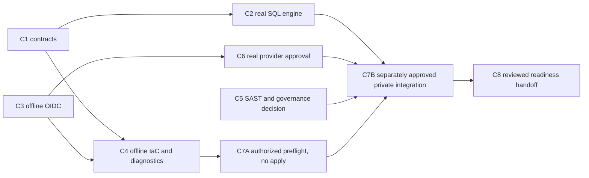

# M4C — Proposed engineering-readiness work packages

Date: 2026-11-10. Status: **assessment/planning authorized; implementation NOT
authorized**. Authority: owner's M4C request, [master brief](../project/master-brief.md),
[M4A preflight](m4a-preflight.md), [M4B scope](m4b-scope.md) and
[current assessment](../evidence/m4c-readiness-assessment.md). M4C subdivides the
existing M4 stage; it adds no master milestone or deployment authority.

The baseline is `40a6353`, hosted run `42794873352`: mandatory policy/application/
containers/required passed, CodeQL skipped. Preserve SQLite, all existing 64 tests,
three application and three container browser journeys, proxy hardening, image
patches, scanners and fail-closed release policy. New tests supplement the existing
assertions. No agent, paid inference, Claims Processing dependency, cloud release,
commit or push is part of these proposals. Deployment remains **NO-GO**.

## Dependency order and authority

Every implementation package needs a new bounded owner request. “Local” below
means no Azure/Entra/GitHub settings access is intrinsically required, not permission
to implement it in this assessment. Local test credentials/engine licenses also
need an explicit decision; local execution is not automatically credential-free.

| Package | Depends on | Proposed boundary | External prerequisites / stop condition |
| --- | --- | --- | --- |
| C1 Repository contract foundation | Confirmed baseline | Entirely local, credential-free tests/documentation; recommended first slice | No SQL connection or engine claim; missing real SQL proof remains Blocked |
| C2 Real SQL engine/driver rehearsal | C1 | Supported isolated local x64 SQL Server or specifically authorized existing test engine | Owner-approved host, pinned image/version/license, TLS and test-principal setup. Current ARM Mac cannot supply a supported SQL Server container |
| C3 OIDC protocol harness | Baseline; can run alongside C1 | Local published fixtures and actual client-library callback behavior, labelled Simulated | No real account, provider registration, operational signing key or cloud login |
| C4 Private SQL/network/identity/diagnostic definitions | C1/C3 configuration contracts; parallel with C2 | Local Bicep, compiled policy/mutations and diagnostic redaction tests only | Actual IDs/CIDRs/SKUs, effective routing/grants and ARM validation remain Blocked |
| C5 SAST and governance route | Baseline; begin decision work early | Local coverage/rights/approval design; later bounded SAST execution if authorized | Owner selects eligible entitlement or supported alternative, review route and reviewer. Settings/billing/visibility changes are separate human actions |
| C6 Real provider token-flow rehearsal | C3; owner-approved identity scope | Real Entra/provider validation with local HTTPS application first | Exact tenant/SPA/API registration, test users/roles/consent and explicit sign-in/token-use authorization; no Azure infrastructure required for this isolated stage |
| C7 Azure preflight and private integration | C4; C7B additionally C2/C5/C6 | C7A read/ARM assessment; C7B separately authorized closed synthetic resource rehearsal | Two distinct cloud approvals; missing session must not cause refresh/login. C7A never authorizes apply; C7B never authorizes production promotion |
| C8 Evidence freeze/readiness decision | Actual evidence from C2/C4/C5/C6/C7B | Local reviewed handoff binding source/images/config/schema/results/cost/teardown | Missing mandatory proof means Blocked/NO-GO, not an accepted exception or a partial “ready” claim |

If a supported local x64 engine is unavailable, C2 stays Blocked. The owner may
instead select an existing dedicated approved SQL target or separately authorize
a SQL-only private bootstrap after C4/C5/C7A; C2 then executes on that target before
C7B's combined application rehearsal. This is an explicit scope decision, never
an automatic cloud/credential fallback or a circular permission inferred from C2.

## C1 — Recommended first implementation boundary

**One credential-free test-only slice.** Proposed files:
`apps/octocat-supply/api/test/contracts/repository.contract.ts`,
`apps/octocat-supply/api/test/repository-sqlite.contract.test.ts`, a focused
contract/evidence document and, only if needed, test configuration/script wiring.
These paths are proposals, not files implemented by this assessment.

Acceptance C1-A1: express the existing `Repository` requirements as reusable adapter
tests and run them against a new isolated SQLite database. Use two synthetic
`oidc:` owner keys for the common contract; retain separate anonymous-demo tests
because SQL deliberately rejects anonymous owners. Preserve original M2 tests,
fixtures, pricing rules, migrations/checksums and business/API behavior unchanged.

Acceptance C1-A2: cover 12 fixture rows, detail/search/category/pagination/tie order,
quantity validation/idempotence, missing resources, every cross-owner cart method,
line removal/cart cleanup and fresh-connection persistence. Two feeders plus three
toys must produce subtotal 31995p, discount 3199p and total 28796p. Probes delete only
their own carts/databases. Test-case IDs map to V01–V05/V08 and T01/T02/T06.

Acceptance C1-A3: publish the same expected SQL-engine case matrix with explicit
Blocked status and prerequisites; create no empty/skipped SQL suite that reports
success. Existing eight recording tests remain labelled Simulated. No SQL Server
image, SQL credential, provider, driver-auth option, application source, Bicep,
workflow, package upgrade or cloud command is allowed in this first slice.

Acceptance C1-A4: all original 64 tests and all new contract assertions pass;
format/lint/types/build, the three browser journeys, existing delivery/security
checks and repository/whitespace checks pass. Record exact SHA, tools, fixture/
schema checksums, case IDs/results and local-only limits. A failure stops this
slice. It does not authorize C2 or establish real SQL readiness.

## C2 — Real SQL Server / driver integration

Proposed surface: a test-only SQL integration factory/runner under
`api/test/integration/`, shared C1 contract, isolated engine definition under
`security/` and focused evidence. Any discovered production defect requires a
reviewed bounded fix and regression evidence, not a speculative adapter rewrite.

Before execution, name a supported Linux Intel/AMD x64 host or approved existing
engine, pin the image/revision/edition and license terms, and approve a dedicated
synthetic test database, resource/time bound, TLS trust and cleanup. Developer
edition has [no production-use rights](https://learn.microsoft.com/en-us/sql/linux/sql-server-linux-faq?view=sql-server-ver17).
If ephemeral SQL bootstrap/runtime/migrator principals or local certificates are
needed, their creation/use/disposal must be explicitly authorized in the future
task. No published test vector becomes an operational credential. Do not add SQL
password/environment fallback to `sqlConfiguration`, `createRuntime` or cloud mode.
`DriverExecutor` already accepts a supplied configuration; isolate any approved
non-cloud connection setup in tests. Test TLS with a matching host and trusted
CA; `trustServerCertificate=true` is not an acceptable way to get green tests.

Acceptance C2-A1: execute C1 contracts using the actual pinned mssql/Tedious path
and real T-SQL. Record engine `@@VERSION`, edition, database compatibility/collation,
client versions and encryption evidence, without tokens/passwords/connection strings.
Check real BigInt/int/nvarchar/UUID conversions, result types, wildcard escaping,
case/tie sorting, invalid inputs and authoritative integer calculations.

Acceptance C2-A2: run fresh migration/seed, replay twice, drift/unknown/reordered
history rejection, two concurrent migrators, a controlled mid-DDL failure and a
seed-drift failure. Verify actual table/history/data state after rollback; counting
callbacks is insufficient. Never reset/down-migrate a cloud/owner database. Only
the owned disposable test fixture can be torn down.

Acceptance C2-A3: use two distinct real connections for at least 20 bounded rounds
of concurrent absolute updates on distinct cart products; each completed round
must retain both intended lines and exact totals. Verify same-product outcomes
are a valid serialized absolute value, plus cross-owner denials, FK/cascade behavior
and complete rollback after injected lock contention/failure. No mutation retries
or silently ignored errors are permitted.

Acceptance C2-A4: prove separate runtime versus migration rights: runtime may read
products/history and mutate owner-checked carts/items, but cannot change products,
DDL, grant rights, create users or access an unrelated fixture database. Migrator
can perform reviewed schema work but is not the runtime or a general server admin.
Verify bad certificate/host, outage, reconnect and timeout behavior fail closed.
Measure configured 1s driver/readiness and 5s HTTP bounds; predeclare at most 250ms
test-scheduler tolerance and report it separately, without changing runtime limits.
Readiness failure must not fail liveness or start DDL; outstanding work/pools remain
bounded. An unconfigured mandatory engine test exits nonzero with a clear blocker.

Evidence must distinguish **Locally tested SQL Server** from Azure SQL/MI/private
network verification. Supported local engine success does not establish cloud
service-tier behavior or M9 backup/RPO/RTO. Run the existing full baseline after
any real defect correction; preserve SQLite and both hardened application images.

## C3 — Local OIDC protocol and credential-safe diagnostics

Proposed surface: focused `AuthApp`/client-library protocol tests and deterministic
OIDC endpoint fixtures, using retained published non-live vectors only. No new
identity-provider service, realm, account or signing credential is needed.

Acceptance C3-A1: exercise actual `UserManager` redirect/callback handling against
controlled responses: S256 challenge/verifier binding, state/nonce, denied consent,
wrong/replayed callback/code, missing/mismatched metadata, token exchange failure,
memory-only tokens, transient state cleanup and callback URL cleanup. Successful
fixtures reach owner-bound catalogue/cart behavior; failures never enter anonymous
mode. Distinguish protocol/network fixtures from real provider execution.

Acceptance C3-A2: exact 401 for absent/invalid/expired/wrong-issuer/audience tokens,
403 for insufficient delegated scope/role and safe 503 for unavailable trusted-key
resolution. Cover the API one-hour age cap versus a later browser expiry and a
usable reauthentication path; any necessary policy/UI change needs specific review.
Known cached valid keys may continue to verify during a JWKS outage; unresolved
keys do not authorize. Readiness stays a database check.

Acceptance C3-A3: design/test a separate real-provider capture profile with no raw
OAuth URL query, code/verifier/state, bearer, private key, auth storage or personal
data retained in traces/HAR/logs/screenshots/artifacts. Use deliberate non-live
canaries to prove redaction and preserve original anonymous E2E coverage/diagnostics.
No insecure TLS, expanded wildcard CSP, default issuer discovery or token endpoint
selected from caller data is allowed. Evidence is **Simulated protocol behavior**
plus actual local library execution, never Entra-verified identity.

## C4 — Offline Bicep, identity and minimum diagnostic completion

Proposed surface: `infra/network.bicep`, `infra/sql.bicep`,
`infra/diagnostics.bicep`, `infra/migrator.bicep`; minimal wiring in existing
foundation/apps/bootstrap definitions, parameter-contract docs and corresponding
delivery validation/policy/mutations. Add no deployment workflow or real parameter
file. New resource coverage must supplement every existing invariant; the current
four-template validation must not silently omit new templates.

Acceptance C4-A1: define a dedicated non-overlapping VNet with delegated ACA subnet
at least /27 and separate SQL PE subnet; reviewed NSG/DNS/route/required-platform
egress model; SQL public access disabled, private endpoint/connection, DNS zone/link
and ordinary verified SQL FQDN. Document SQL connection policy and necessary ports;
do not assume TCP 1433 alone covers every policy. Preserve internal API/external
frontend HTTPS, fixed host/SNI/CA checks and authenticated public Basic ACR choice.
No paid resolver/NAT/Firewall/Premium registry is added without a revised decision.

Acceptance C4-A2: complete explicit runtime/migrator/publisher/release/pull identity
and grant manifests; no runtime DDL/admin rights or migrator attached to the API.
Retain the five-dedicated-identity ceiling from M4B unless a separately justified
SQL directory-lookup requirement changes it. Entra registrations/consent and SQL
contained users are separate reviewed bootstrap operations, not implicit Azure
RBAC grants or self-bootstrapping release authority. Exact GitHub subject discovery
is deferred until its protected route is approved; no guessed subject or wildcard.

Acceptance C4-A3: candidate minimal console/system diagnostic sink with supported
retention/ingestion/access settings, release/revision/image/config/schema correlation
and safe dependency error classes. Keep HTTP/auth callback query capture off until
redaction is proven. Test token/connection-string/owner/body canaries and distinguish
DNS/TLS/SQL/schema failures without emitting their sensitive contents. No M6
dashboards, distributed collector, broad tracing/SLO or agent platform is included.

Acceptance C4-A4: lint/build every template offline, enforce all old and new
compiled-resource checks, run negative mutations for public SQL/API, weak TLS,
bad trust, overbroad grants, runtime/migrator sharing, missing private DNS, capacity
and unsafe logs. Record Trivy's finite coverage and supplement it with explicit
policy tests. Compile success remains **Design only/static local validation**,
not ARM validation or effective Azure enforcement.

## C5 — SAST and governance route, decided early

Owner must choose a supported private CodeQL arrangement with entitlement and
actual results, or a licensed/supported SAST alternative plus explicit coverage
review. Current private personal/Pro status does not establish private CodeQL
eligibility. Pro branch protection, Code Security entitlement and private required
deployment reviewers are separate features. No purchase, transfer, visibility,
settings, variable, environment or CodeQL activation is authorized by this plan.

Acceptance C5-A1: inventory TypeScript/TSX/API/auth/data-access attack paths, select
and pin engine/rules/licenses, justify coverage gaps, and obtain a real scan of the
reviewed SHA with seeded positive/negative security controls and human-reviewed
findings. Preserve fail-closed HIGH/CRITICAL handling and no automatic exceptions.
ESLint, dependency audits and image scans cannot fill in a missing SAST result.
Local CodeQL execution cannot bypass its license restrictions. A skipped CodeQL
job stays a coverage gap until the approved alternative is actually executed.

Acceptance C5-A2: either verify enforceable required checks/independent PR review/
stale-review dismissal/no bypass and supported reviewer environments, or obtain
explicit selection of ADR 0005's owner-operated release fallback with equivalent
manifest-bound independent review. A missing independent reviewer remains Blocked.
Prepare approval/denial tests without changing settings. Automatic publishing,
deployment and GitHub OIDC issuance remain absent unless separately authorized.

## C6 — Separately authorized real provider rehearsal

Entry: C3 passes; owner authorizes the exact tenant, two SPA/API registrations,
API token version/audience/scope/role, consent, exact HTTPS redirect/CORS origin,
test principals, bounded sign-in attempts and credential-safe evidence/cleanup.
Use local HTTPS app + SQLite first to isolate provider behavior; this is still a
real cloud identity interaction requiring permission. No password automation,
client secret, offline-access/refresh-token fallback or copied credentials.

Acceptance C6-A1: actual code+PKCE and provider-issued API access tokens work for
two owners, with catalogue/search/cart/price/refresh/reauthentication and cleanup;
prove both users' cart read/set/remove/delete denial, role/scope denials, ID-token/
wrong-audience rejection, expiry behavior and exact issuer/JWKS/CSP compatibility.
Record sanitized claim semantics and results, not raw subjects/tokens. API and
ID-token subjects may differ; stable access-token ownership must not be inferred
from the browser storage identity. Confirm local-only sign-out semantics honestly.

Acceptance C6-A2: rejected/replayed callback/code and provider/JWKS outage preserve
fail-closed behavior; natural provider rotation is observed where available, while
deterministic rotation remains labelled Simulated. A valid foreign-tenant token
requires an already approved independent test identity/issuer; do not create a
second tenant or mislabel a tampered token as a real foreign-tenant test. Any
unavailable mandatory real denial stays Blocked. No provider setting/key outage
is induced without its own scope; use an isolated client-side fault where approved.

## C7 — Two separately approved Azure boundaries

**C7A: read-only preflight and parameterized ARM assessment.** Requires a valid
explicitly authorized Azure session/scope first. Verify subscription/tenant/actor,
effective RBAC/deny/policy/locks, providers, regional SKUs/quota/capacity, dedicated
resource names/CIDRs and registry/SQL prerequisites; reprice exact resources and
managed networking. ARM validate/what-if need their own scoped authorization and
reviewed parameters. No registration, role grant, identity creation, budget, Entra
mutation or resource apply follows from a successful read. If auth is missing or
expired, stop without refresh/login/alternate credentials.

**C7B: closed synthetic private integration rehearsal.** Requires a new approval
binding C2/C5/C6 results, C4 templates and C7A findings to exact mutations/IDs/
actors/digests/config/schema, cost ceiling, expiry, rollback and teardown. Prefer
an already approved dedicated test environment; otherwise any new resource work
must stay within M4B Slice 2's separately reviewed ceiling: one project RG/VNet,
two subnets, one Consumption environment/two max-one apps, Basic registry, one
<=2GB Basic SQL database/server/PE/DNS, one bounded migrator and diagnostics
workspace, at most five dedicated identities and two SPA/API registrations. Any
change of tier/network/identity count or retention needs revised scope/cost review.
Maximum proposed exercise window remains 48 hours, not an approved duration/spend.

Acceptance C7-A/B: capture real private DNS resolution and encrypted login, SQL
MI acquisition/renewal on the locked driver with explicit client ID, separate
migrator execution (one execution/parallelism, <=10 minutes, no unapproved retry),
exact fixture/schema and runtime data-versus-DDL denials. Outside-network SQL access
must fail with public access disabled; outside-environment callers must not obtain
API data even with an otherwise valid token. Record actual denial status/reason,
not an assumed HTTP code. Positive authenticated frontend journeys must pass.
Registry pulls/role propagation, wrong-identity denials, bounded DB outage/readiness
failure, liveness survival, fresh recovery and data across app replacement need
actual results. Repeat relevant C2 cases on Azure SQL; local SQL Server was not
proof of Azure SQL compatibility. Never expose anonymous carts/public SQL or use
password/default-chain/SQLite/TLS fallback to repair a failed rehearsal.

Diagnostics must identify controlled failures and correlate approved manifest to
revision without leaking credentials. Capture actual resource/usage inventory,
actor, elapsed window, costs and teardown including managed infrastructure/identity
bindings. Missing SAST/governance/permissions or any failed gate stops exposure;
this is not production deployment/promotion or autonomous recovery.

## C8 — Evidence freeze and readiness handoff

Acceptance C8-A1: independently review case-by-case expected/actual outcomes and
limits for C2/C4/C5/C6/C7B. Bind exact reviewed source/lock/tool/config/schema hashes,
fresh full tests/scans/SBOMs, approved registry manifest digests and actual cloud
IDs/permissions/diagnostics to one release candidate. Changed inputs invalidate
approval; local image IDs or unsigned CI provenance are not signed registry proof.
Preserve failures/blocks and label Simulated/Locally tested/Cloud verified by their
actual environment. No readiness result is earned by a document or a job name.

Acceptance C8-A2: record a genuinely tested compatible image/config/schema pair,
bounded human release/rollback procedure and data/teardown decisions. Never choose
old M2 images against SQLite schema 3 or invent a previous cloud-good SQL pair.
M9 restore/RPO/RTO, 28-day SLOs, agents/inference and full M6 telemetry stay outside
M4C. A successful readiness handoff requests later release direction; it is not
permission to publish/deploy. If mandatory evidence is absent, conclude NO-GO with
named blockers and stop rather than widen scope.

## Potential costs and decisions before execution

| Work | Potential costs / approval requirement |
| --- | --- |
| C1/C3/C4 and local C5 preparation | No Azure consumption required on owned hardware; local compute/storage/downloads and engineering time remain. No new paid tool or provider is selected |
| C2 supported engine | Developer license is non-production/free subject to its terms; x64 hardware, hosted CI minutes/storage or rented compute can cost money. No permanent Azure VM or emulated ARM substitution is assumed. Test credentials/license acceptance require explicit scope |
| C5 security/governance | [Code Security list price](https://github.com/security/plans) is $30 USD per active committer/month at assessment, plus eligible base-plan/organization and any Enterprise reviewer requirements; this is not a quote for this personal repo. Alternative SAST has its own engine/rule/support/CI terms. No subscription or plan change is approved |
| C6 real provider | Tenant/test-user/admin work and any premium identity/conditional-access features depend on existing entitlements. Do not assume availability or purchase a tier; local app hosting does not remove the identity authorization boundary |
| C7 private cloud rehearsal | ACA/app and migrator compute, ACR, SQL, PE, private DNS, managed IP/load balancer, data/backup and diagnostic ingestion/retention. Reprice region/SKU/provider/network policies before approval; max replicas and budget alerts are not a hard spending cap |

The [M4A model](../project/azure-cost-estimate.md) is historical, unapproved and not
repriced here: £5.03 for its proposed 48-hour assumptions, proposed £10 ceiling,
£51.20/month low-duty and £102.32/month continuously active, pre-tax. These exclude
GitHub/SAST/premium identity and contain unverified network allowances; they are
not authorization or a current forecast. C7A must produce a dated itemized quote,
contingency, approval ceiling, expiry and teardown/control inventory before C7B.
Any paid managed service, extra test VM, broader network appliance or extension
of the window needs new authorization. No Azure resource consumption or paid-service
execution was initiated by this assessment.

Each package's evidence must record actor/authorization, source and environment,
UTC times/commands, case IDs, expected/actual statuses, failures, scanner coverage,
sanitized hashes and explicit limits. Keep raw sensitive artifacts out of Git;
update only relevant summaries and capability status. Current authority stops at
this plan. **Recommended next request: C1 only**, without engine/provider/cloud
credentials, IaC implementation, settings or release execution.
