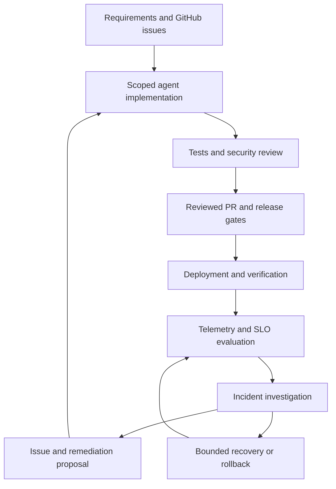

# Master Brief — Enterprise Agentic SDLC & Reliability Platform

**Use this entire brief as the context for a fresh Codex implementation chat.**

The hackathons have ended. **Suspend the previous event challenge roadmap as the implementation plan.** Preserve its working code, lessons and evidence, then use them to build a coherent personal portfolio project.

This brief defines the eventual destination. It does not instruct Codex to implement everything at once.

## 1. Project identity

**Project title:** Enterprise Agentic SDLC & Reliability Platform

**Purpose:**

> Build and operate a software product through an agent-assisted engineering lifecycle—from requirements and issue triage through implementation, testing, security review, deployment, monitoring, incident diagnosis, controlled remediation and continuous improvement.

The project should demonstrate both:

- **Building software with agents.**
- **Operating and maintaining software with agents.**

Use the existing OctoCAT Supply application as the initial reference workload. Its products, search, cart, pricing and API dependencies provide realistic behaviour to test and operate.

The platform must demonstrate engineering decisions and operational evidence, rather than simply assembling AI tools.

## 2. Repository strategy

Maintain **two separate portfolio repositories**:

| Repository | Primary purpose |
|---|---|
| **Agentic Claims Processing** | Business AI: document understanding, extraction, RAG, orchestration, evaluation and governance |
| **Agentic SDLC & Reliability** | Engineering AI: requirements, development, tests, DevSecOps, delivery, reliability and maintenance |

**This brief covers Agentic SDLC & Reliability only.**

Shared security or observability patterns may be referenced between them, but Claims Processing should not become a second application inside this repository.

For this project:

- Inspect and extend the existing personal **`octocat-supply-Agentic-AI`** repository where practical.
- Treat that name as a repository candidate to verify, not proof of current access or state.
- Consider a professional rename only after assessing repository history, links and existing positioning.
- Do not create another overlapping personal SDLC repository unnecessarily.
- Keep contributions to upstream projects in their appropriate forks and pull requests.

The temporary hackathon organisation and lab account must not become dependencies of the personal implementation.

## 3. Portfolio positioning

The repository should provide evidence relevant to:

- Agentic AI Engineer.
- AI Platform Engineer.
- DevSecOps Engineer.
- Platform Engineer.
- Site Reliability Engineer.
- Cloud Engineer or Solution Architect.
- Microsoft Cloud Solution Architect or Solution Engineer.

A reviewer should be able to inspect:

| Engineering capability | Expected evidence |
|---|---|
| Agent-assisted development | Issues, instructions, scoped changes, tests and reviewed PRs |
| Agent orchestration | Triggers, tools, permissions, handoffs and execution records |
| DevSecOps | Threat model, security checks, identity boundaries and release controls |
| Infrastructure engineering | Reproducible IaC, configuration and deployment evidence |
| Reliability engineering | SLIs/SLOs, telemetry, incidents, recovery and prevention |
| Architecture | Requirements, trade-offs, ADRs and service boundaries |
| Collaboration | Focused upstream contributions and review responses |
| Technical communication | Reproducible walkthroughs, runbooks and honest demonstrations |

Do not position the project as training a foundation model. Its AI engineering value comes from **tool use, context, workflow design, evaluation, governance and operational integration**.

## 4. Enterprise scenario and business problem

Use a fictional organisation operating **OctoCAT Supply**, a small commerce application.

The application is a manageable workload through which to demonstrate substantial engineering practices.

The fictional team faces:

- Growing feature requests and maintenance work.
- Repeated manual issue investigation.
- Inconsistent tests and deployment confidence.
- Dependency and security maintenance.
- Limited visibility into user-facing failures.
- Configuration changes that can break dependencies.
- Time-consuming incident diagnosis.
- Weak links between incidents, engineering fixes and prevention.

The desired outcomes are:

1. Faster, traceable delivery of small changes.
2. Better defect detection before release.
3. Controlled agent access to code and operational tools.
4. Reproducible deployments and recovery.
5. Evidence-backed incident diagnosis.
6. An auditable path from operational problem to reviewed fix.
7. Reduced repetitive work without removing human accountability.

Any improvement claims must be measured against recorded baselines. Do not invent percentage savings.

## 5. Starting context and historical evidence

Two relevant foundations exist: the personal rehearsal and the event implementation.

### Personal rehearsal

The earlier personal repository reportedly demonstrated:

- Shopping cart and discounts.
- Automated tests and Playwright.
- GitHub Actions and security scanning.
- Container images.
- Azure Container Apps.
- Bicep infrastructure.
- GitHub-to-Azure OIDC.
- Health checks and KQL troubleshooting.

**Codex must verify which assets actually exist and remain reusable.**

### Hackathon implementation

The event repository was:

[Hackathon lab repository](https://github.com/MngEnvMCAP447224/microhack-sdlc-labuser-0039)

Historical milestones recorded in this conversation:

| Evidence | Historical reference |
|---|---|
| API-backed cart | Commit `8d051f0` |
| Product search and filtering | Commit `b500378` |
| Testing and cart review fix | Commit `8b4d207` |
| Successful deployment | Commit `ee54e55` |
| Agentic issue-triage implementation | Commit `96d6021` |

The deployment demonstrated an external frontend, internal API, SQLite migrations, 12 seeded products, search and cart operations.

Historical deployment evidence:

[Successful deployment workflow](https://github.com/MngEnvMCAP447224/microhack-sdlc-labuser-0039/actions/runs/40508682942)

These references are **historical evidence, not guarantees of current availability**. Lab credentials, URLs and resources may have expired or been removed.

### Verified SRE experiment

A controlled frontend configuration fault changed `API_PORT` from `443` to `444`.

The Azure SRE Agent:

- Established a baseline.
- Correlated the configuration change with a new frontend revision.
- Found Nginx upstream connection timeouts and HTTP 504 responses.
- Identified the wrong upstream port.
- Proposed restoring `443`.
- Independently confirmed sampled recovery after rollback.

The frontend’s static `/` route remained healthy during the dependency failure. This revealed a meaningful readiness gap.

A Codespaces watchdog performed rollback; **the SRE Agent did not autonomously apply the repair**.

### Unresolved C7 result

The GitHub Agentic Workflow validated, compiled and was pushed, but its real run failed at inference authorisation.

[Historical failed agentic run](https://github.com/MngEnvMCAP447224/microhack-sdlc-labuser-0039/actions/runs/40531224826)

No useful triage comment was published.

The portal showed **7/7 complete**, while the technical evidence established:

- C1–C6 validated.
- C7 implemented, with successful execution still unverified.

The personal implementation must close this gap using supported authentication and a genuine successful run.

## 6. Reference repositories

Use these as sources to inspect, attribute and selectively learn from:

| Reference | Intended use |
|---|---|
| [Microsoft microhack SDLC](https://github.com/markharrison/microhack-sdlc) | Event guidance and starter context |
| [Azure Samples OctoCAT Supply](https://github.com/Azure-Samples/octocat-supply) | Application and SDLC patterns |
| [Microsoft SRE Agent](https://github.com/microsoft/sre-agent) | Operational examples, labs, integrations and contribution opportunities |
| [GitHub Copilot Hands-on](https://github.com/Azure-Samples/github-copilot-hands-on) | Agent-assisted engineering and educational patterns |
| [GitHub Agentic Workflows](https://github.com/github/gh-aw) | Agentic maintenance workflows and supported execution model |

At implementation time, verify:

- Current documentation and versions.
- Repository purpose and contribution rules.
- Licences and attribution requirements.
- Relevant commits, issues and PRs.
- Compatibility with the personal implementation.

Do not assume the Microsoft SRE Agent repository contains the complete commercial product source.

Previously referenced federation PRs **#385 and #386** are discovery leads to verify. Their status and suitability are not established by this brief.

## 7. Target architecture

The core application remains deliberately small:

- React frontend.
- TypeScript API.
- Repository/data-access layer.
- A persistence solution selected from actual durability requirements.
- Containerised execution.
- Azure deployment as the primary cloud implementation.

Surround it with an engineering and operational lifecycle:



Cross-cutting controls:

- Identity and least privilege.
- Agent/tool permissions.
- Human review.
- Auditability.
- Cost controls.
- Reproducibility.
- Evaluation.
- Evidence classification.

Do not introduce a large custom multi-agent framework unless a concrete requirement justifies it.

## 8. Agent responsibilities

Separate responsibilities even if some initially share an execution platform.

| Responsibility | Expected behaviour |
|---|---|
| Issue triage | Read context, classify the problem, identify missing information and suggest next steps |
| Development | Implement a bounded change on a branch and provide meaningful tests |
| Review | Examine correctness, security, data integrity and regression risks |
| Maintenance | Investigate dependencies, documentation drift or recurring repository tasks |
| SRE investigation | Correlate symptoms, telemetry, configuration and deployment history |
| Remediation coordination | Create actionable work and route it to an authorised human or agent |
| Recovery verification | Check fresh evidence after a repair or rollback |

Agent roles do not need separate services merely to make an architecture diagram look sophisticated.

## 9. Full SRE operating scope

The SRE workstream must extend beyond the hackathon’s single diagnostic exercise.

### Reliability definition

Establish:

- Critical user journeys.
- Service-level indicators.
- Explicit SLOs and measurement windows.
- Error-budget calculations and release implications.
- Severity and escalation criteria.

Include user-facing API journeys. A successful static homepage is insufficient evidence of application health.

### Observability

Implement useful:

- Structured logs.
- Metrics.
- Distributed traces where justified.
- Request/correlation identifiers.
- Deployment and configuration annotations.
- Dependency-aware health checks.
- Dashboards and actionable alerts.

Avoid collecting telemetry without a clear diagnostic or operational purpose.

### Incident management

Demonstrate:

- Detection and acknowledgement.
- Impact assessment.
- Evidence collection and timeline.
- Root-cause hypotheses with confidence.
- Mitigation versus permanent repair.
- Escalation and ownership.
- Recovery verification.
- Blameless postmortems and prevention work.

### GitHub engineering handoff

The eventual workflow should support:

1. An incident or reliability finding creates a structured GitHub issue.
2. Duplicate findings link to existing work.
3. Severity, impact, evidence and acceptance criteria are recorded.
4. Work is routed to an authorised human or coding agent.
5. A coding agent proposes a branch and PR with tests.
6. Independent checks and human review assess the proposal.
7. An authorised release process deploys it.
8. Fresh telemetry verifies recovery.
9. The issue and incident record receive the outcome.

**Verify each integration before claiming it exists.** If direct SRE Agent issue creation or coding-agent assignment is unsupported, implement a documented connector or human handoff.

### Wider operational practice

Include proportionate demonstrations of:

- Capacity and performance investigation.
- Backup and restore.
- Recovery objectives.
- Configuration drift.
- Dependency maintenance.
- Toil reduction.
- Runbook upkeep.
- Controlled fault exercises.
- Cost and resource hygiene.

Cover the breadth of SRE responsibilities through a capability matrix. Do not claim that every human SRE responsibility has been automated.

## 10. Security and agent governance

Create a threat model covering both the application and its agents.

Mandatory controls include:

- Separate read, propose and execute permissions.
- Short-lived federation where supported.
- No credentials committed to source.
- Untrusted treatment of issues, logs, repository content and tool outputs.
- Prompt-injection and secret-exfiltration tests.
- Tool/input validation.
- Bounded execution time, retries and scope.
- Protected release paths.
- Audited approvals and actions.
- Safe failure when credentials or permissions are unavailable.

For GitHub maintenance workflows, keep inference access separate from repository-write permissions.

For operational remediation, define:

| Action class | Expected control |
|---|---|
| Read telemetry | Scoped read access |
| Suggest a repair | Evidence-backed proposal |
| Create a maintenance issue | Restricted, deduplicated output |
| Open a repair PR | Branch-scoped changes and CI |
| Deploy or alter runtime configuration | Explicit release policy and approval |
| Destructive or broad access change | Separate review and narrowly scoped execution |

Do not carry the lab’s resource-group Owner deployment role into the personal architecture without assessing a narrower alternative.

## 11. Persistence and deployment maturity

Ephemeral SQLite was acceptable for the temporary lab. It must not silently become a durability claim for the portfolio.

Assess:

- Whether SQLite remains appropriate for local development.
- Durable cloud storage or database requirements.
- Migration behaviour.
- Backup and restoration.
- Concurrency.
- Container replacement.
- Data integrity during rollback.

Select the smallest appropriate solution and record the trade-off.

The primary delivery path should use GitHub Actions, container images and Azure IaC, preserving working Bicep assets where suitable.

Azure DevOps, Jenkins and Kubernetes remain possible extensions from the wider portfolio strategy. Add them only for a distinct demonstration, such as an alternative delivery path or deployment target. They must not duplicate the core pipeline without purpose.

## 12. Testing and evaluation

Testing must cover application behaviour and agent behaviour.

**Application and infrastructure:**

- Unit and integration tests.
- API validation and error behaviour.
- Frontend component tests.
- End-to-end journeys.
- Container smoke tests.
- Infrastructure validation.
- Security checks.
- Migration and recovery checks.

**Agents and workflows:**

- Successful task completion.
- Evidence quality and relevant citations.
- Appropriate uncertainty.
- Permission boundaries.
- Malicious issue/log content.
- Duplicate issue handling.
- Unavailable tools or inference.
- Incorrect repair suggestions.
- Time and usage limits.
- Human escalation.

A green workflow alone does not prove success. Inspect the actual maintenance output and resulting behaviour.

## 13. Required demonstration scenarios

| Scenario | Evidence required |
|---|---|
| Feature request to reviewed PR | Requirement, agent change, tests and review |
| Agentic maintenance | Successful real inference and useful repository output |
| Dependency failure masked by static health | Failure signal, improved detection and regression tests |
| Configuration regression | Change history, diagnosis, repair and recovery |
| Failed release | Gate or smoke-check failure and rollback |
| Unsafe instruction in issue/log content | Rejected instruction and preserved permissions |
| Durable recovery | Verified restoration against declared objectives |
| Performance or capacity problem | Measurements, diagnosis and validated improvement |

Reuse the wrong-port incident as a known historical scenario, then build a reproducible local/container version before considering another live fault.

## 14. Upstream change and contribution register

Maintain a version-controlled register with:

- Source repository.
- Commit, PR or issue.
- Date assessed.
- Technical relevance.
- Licence/attribution.
- Whether already implemented.
- Adoption decision and rationale.
- Dependencies.
- Test evidence.
- Contribution opportunity.
- Walkthrough relevance.

This connects:

**Upstream change → relevance → personal integration → contribution opportunity → demonstration.**

Keep upstream contribution work independent:

- Inspect guidelines and existing work.
- Reproduce the problem.
- Select a focused improvement.
- Add appropriate validation.
- Submit a small PR.
- Respond to review.
- Record its actual status.

Do not describe a proposed contribution as accepted or merged.

## 15. Optional multi-cloud extensions

After the Azure core is validated, assess isolated modules for:

- Microsoft Entra to AWS federation.
- Microsoft Entra to GCP Workload Identity Federation.
- Cross-cloud diagnostic access.
- Terraform-based integration examples.

Requirements:

- Verify current upstream guidance.
- Separate cloud identities and permissions.
- Define trust subjects, audiences and scopes.
- Prefer read-only demonstrations initially.
- Test rejected identity cases.
- Avoid long-lived cloud keys.
- Provide deployment, verification and teardown instructions.
- Record costs and residual resources.

These modules must remain optional. The core application must function without AWS or GCP.

## 16. Implementation roadmap

**This replaces the event challenge sequence.**

| Milestone | Outcome and exit evidence |
|---|---|
| **M0 — Assess and preserve** | Repository inventory, reusable assets, historical evidence, gaps and chosen source of truth |
| **M1 — Product and architecture foundation** | Charter, requirements, capability matrix, architecture, threat model and ADRs |
| **M2 — Reproducible application baseline** | Fresh setup, functioning journeys, meaningful tests and documented persistence |
| **M3 — Secure delivery** | CI, security checks, image build, IaC validation, scoped identities and release controls |
| **M4 — Personal Azure deployment** | Verified deployment, internal API boundary, durability decision, smoke checks and recovery procedure |
| **M5 — Working agentic maintenance** | Genuine workflow execution, useful output, least privilege and reviewed evidence; closes C7 gap |
| **M6 — Observability and reliability** | Telemetry, dependency checks, SLIs/SLOs, dashboards and actionable alerts |
| **M7 — Incident diagnosis and recovery** | Controlled experiment, actual SRE Agent findings, bounded rollback and independent recovery |
| **M8 — Incident-to-PR lifecycle** | Issue creation/deduplication, authorised assignment, repair PR, review, release and verification |
| **M9 — Operational assurance** | Restore test, resilience/security evaluations, performance exercise, runbooks and cost evidence |
| **M10 — Upstream collaboration** | Verified integration register and a focused contribution submitted where appropriate |
| **M11 — Optional extensions** | Justified multi-cloud or alternative delivery modules, independently validated |
| **M12 — Portfolio and walkthrough** | Evidence index, professional README, architecture narrative, limitations and reproducible video demonstration |

Security and evidence apply throughout; their presence in a milestone does not defer them until that stage.

## 17. Evidence standard and definition of done

Track each major capability as:

- Planned.
- Implemented.
- Locally tested.
- Cloud verified.
- Simulated.
- Design only.
- Blocked.
- Retired.

Record the relevant version, environment, date, test or run, result and limitation.

The project is complete when a reviewer can follow at least one verified journey:

> Requirement → agent-assisted change → reviewed tests → secure release → monitored service → detected incident → evidence-backed diagnosis → engineering issue → reviewed repair → recovery verification → prevention.

Do not claim:

- Production usage from a lab deployment.
- Autonomous remediation when an operator or watchdog acted.
- Full availability from a sampled successful request.
- Successful agent maintenance from compilation alone.
- Measured gains without baseline measurements.

## 18. YouTube and portfolio presentation

Prepare one main walkthrough supported by shorter decision-focused videos.

Suggested main title:

**Building an Agentic SDLC and Reliability Platform with GitHub Copilot and Azure SRE Agent**

The main demonstration should cover the validated core. Add MCP and multi-cloud identity to titles only when those integrations are actually demonstrated.

Show:

- The business problem.
- Architecture and identity boundaries.
- A real development or maintenance task.
- Tests and review.
- Deployment evidence.
- Incident diagnosis.
- Repair and recovery.
- Limitations and cost decisions.

Preserve upstream attribution and redact credentials, personal identifiers and sensitive logs.

## 19. Codex working method

Use this loop:

1. Inspect the current state.
2. Select one bounded milestone.
3. Implement its necessary changes.
4. Run appropriate checks.
5. Review and fix actionable findings.
6. Update evidence and documentation.
7. Commit and push when authorised.
8. Report the result and stop at the milestone boundary.

Preserve useful work. Avoid unnecessary frameworks, duplicate pipelines, decorative documentation and inflated test counts.

Cloud resources and paid inference require an explicit deployment scope, identity plan, cost estimate and teardown approach before execution. Budget alerts are not spending caps.

## 20. Opening instruction for the new Codex chat

Paste this after the master brief:

```text
Use the Enterprise Agentic SDLC & Reliability Platform master brief above as the authoritative project direction.

The hackathons have ended. Their challenge roadmap is suspended as our implementation plan. Preserve useful code, lessons and evidence, then develop the personal portfolio through the new milestones.

Keep Claims Processing separate.

Start with M0 — Assess and Preserve only.

1. Inspect the accessible personal Agentic SDLC repository, including instructions, application code, infrastructure, workflows, tests and documentation.
2. Verify the repository’s identity, branch, remote and current state. Do not assume the temporary lab repository or resources remain accessible.
3. Compare the personal rehearsal assets and any available hackathon implementation against this brief.
4. Identify reusable assets, obsolete assumptions, missing evidence and actual gaps.
5. Preserve the historical distinction between portal completion and technical completion: C7 compiled but its real inference run failed.
6. Assess the persistence, deployment identity, agent permissions and monitoring design.
7. Identify relevant upstream references and licence obligations without importing changes yet.
8. Produce the capability/status matrix and propose the exact M1 scope.

Report:
- Existing repository assessment.
- Reusable assets and evidence.
- Gaps and conflicts.
- Material proposed for retirement.
- Proposed M1 scope and expected files.
- Risks, access limitations and decisions needed.

Do not implement later milestones, provision cloud resources, create credentials, run paid inference, or alter scheduled monitoring in this first task.

Stop after the M0 assessment and proposed M1 scope.
```

**The central story is a software engineering team adopting agents across delivery and operations, with working code, controlled actions and verifiable outcomes behind every major claim.**
